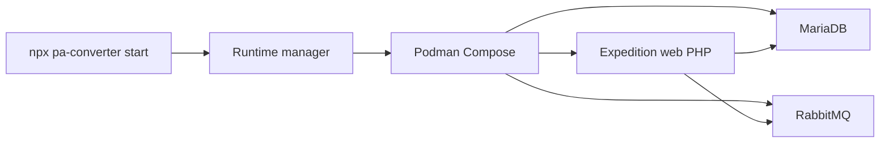

<div align="center">

# PA-Converter

### Palo Alto Expedition · Firewall Config Converter

[](https://github.com/TufaylAhmed/PA-Converter)
[](https://www.npmjs.com/package/@tufayl/pa-converter)
[](https://github.com/TufaylAhmed/PA-Converter)
[](https://github.com/TufaylAhmed/PA-Converter)
[](https://nodejs.org/)

**Convert · Import · Optimize · ML-assist** firewall configurations with Expedition — **no Docker Desktop**.

```
╔══════════════════════════════════════════════════════════════╗
║   Vendor configs  ──►  PA-Converter  ──►  PAN-OS XML         ║
║       Fortinet · Cisco · Checkpoint · Palo Alto · more       ║
╚══════════════════════════════════════════════════════════════╝
```

[Quick Start](#quick-start) · [Architecture](#architecture) · [CLI](#cli-commands)

</div>

---

## Overview

**PA-Converter** packages **Palo Alto Networks Expedition 5.45.4** for **macOS, Windows (WSL2), and Linux**.

| Platform | Default runtime |
|----------|-----------------|
| **macOS / Linux** | **Podman Compose** (MariaDB + RabbitMQ + Expedition web) |
| **Windows** | **WSL native** (Apache/PHP/MariaDB/RabbitMQ/Spark) or MSI |

| Capability | Status |
|:-----------|:------:|
| Expedition web UI (HTTPS) | ✅ |
| Seed login (`admin` / `paloalto`) | ✅ |
| Palo Alto `running-config.xml` import | ✅ |
| Fortinet config import | ✅ |
| Background jobs (RabbitMQ + PanOrders) | ✅ |
| Machine Learning / Spark 2.4 | ✅ |
| macOS via Podman (fast, faithful) | ✅ |
| Windows WSL2 (no Docker Engine) | ✅ |

> For engineering / lab use. Expedition itself remains Palo Alto Networks software.

---

## Quick Start

### Prerequisites

| Platform | Requirement |
|----------|-------------|
| **All (npx)** | Node.js 18+ |
| **macOS / Linux** | [Podman](https://podman.io) + Compose provider (`podman compose` or `podman-compose`) |
| **Windows** | WSL2 Ubuntu (or the MSI) — **not** Docker Desktop |

**macOS first-time Podman:**

```bash
brew install podman
podman machine init --cpus 4 --memory 4096 --disk-size 60
podman machine start
```

**No login, token, or `.npmrc` required** for end users.

| Path | Who | Command / download |
|------|-----|-------------------|
| **npm / npx** | macOS / Linux / Windows+WSL | `npx @tufayl/pa-converter start` |
| **MSI / portable ZIP** | Windows | [GitHub Releases](https://github.com/TufaylAhmed/PA-Converter/releases) |
| **git clone** | contributors | clone this repo, then `npm start` |

> If an old `~/.npmrc` still has `@tufaylahmed:registry=https://npm.pkg.github.com`, **delete that line** or installs may ask for a GitHub PAT.

---

### macOS / Linux / Windows (npx)

```bash
npx @tufayl/pa-converter@5.46.28 start

npx @tufayl/pa-converter status
npx @tufayl/pa-converter logs -f
npx @tufayl/pa-converter stop
```

If npm is still validating a new version, run from GitHub:

```bash
npx --yes github:TufaylAhmed/PA-Converter#v5.46.28 start
```

First `start` builds the web image and pulls MariaDB/RabbitMQ (several minutes). Then open **https://localhost:18443** (accept the self-signed cert) → `admin` / `paloalto`.

On Windows, the CLI runs install/start **inside WSL** (`wsl.exe`). Install WSL first if needed: `wsl --install -d Ubuntu`.

**Runtime overrides:**

```bash
PA_CONVERTER_RUNTIME=podman npx @tufayl/pa-converter start   # default on macOS/Linux
PA_CONVERTER_RUNTIME=docker npx @tufayl/pa-converter start   # Docker Desktop
PA_CONVERTER_RUNTIME=native npx @tufayl/pa-converter start   # Homebrew / apt (legacy)
```

---

### Windows — self-contained `.msi` (recommended)

**End users only need the MSI** — no Docker Desktop, Node.js, or npm account.

1. Download **`PA-Converter-5.46.46.msi`** (or the portable ZIP) from [Releases](https://github.com/TufaylAhmed/PA-Converter/releases).
2. Run the MSI (allow UAC). Leave **Finish setup** checked.
3. If Windows asks to reboot to enable WSL, reboot once — setup continues automatically.
4. Wait for first-time provisioning (apt packages + Spark inside WSL — **no Docker Engine**).
5. Open **https://localhost:18443** → `admin` / `paloalto`.

Later: Start Menu → **PA-Converter** → **Start / Stop / Status**.

> Needs 64-bit Windows 10/11, BIOS virtualization, and internet on **first** setup only.

Build the MSI (CI/Windows):

```powershell
cd installer\windows
powershell -ExecutionPolicy Bypass -File .\build.ps1 -Version 5.46.46
```

---

### Run from git clone

```bash
git clone https://github.com/TufaylAhmed/PA-Converter.git
cd PA-Converter
npm start
```

| Protocol | URL |
|:---------|:----|
| HTTPS | **https://localhost:18443** |
| HTTP  | http://localhost:18080 |

```
admin / paloalto
```

### Ports

| Environment variable | Default | Role |
|:---------------------|:-------:|:-----|
| `EXPEDITION_PORT` | `18443` | HTTPS |
| `EXPEDITION_HTTP_PORT` | `18080` | HTTP |

---

## Architecture



On Windows MSI / `PA_CONVERTER_RUNTIME=native`, the same stack runs as host services inside WSL (Apache + MariaDB + RabbitMQ + Spark).

| Component | Role |
|:----------|:-----|
| Expedition web (container or Apache) | UI + APIs |
| MariaDB | Seed schemas (`databases/`) |
| RabbitMQ | Job queue for PanOrders |
| Spark 2.4 (in web image / native) | ML jobs |

---

## CLI Commands

```bash
pa-converter start      # Start Podman stack (or WSL native on Windows)
pa-converter stop       # Stop containers / native services
pa-converter status     # Container or service status
pa-converter logs [-f]  # Follow logs
pa-converter build      # Rebuild web image (Podman/Docker)
pa-converter url        # Print UI URL
```

```bash
export EXPEDITION_PORT=18443
export EXPEDITION_HTTP_PORT=18080
export PA_CONVERTER_RUNTIME=podman   # or docker | native
```

---

## Repository layout

```
PA-Converter/
├── README.md
├── package.json
├── bin/expedition.js         # CLI (Podman default on macOS/Linux; WSL native on Windows)
├── app/                      # Expedition web root
├── databases/                # Seed SQL
├── docker/                   # Compose + web Dockerfile (Podman/Docker)
├── native/                   # WSL/Linux/macOS native fallback
└── installer/windows/        # MSI + WSL provision (native)
```

---

## Publish (maintainers)

```bash
npm login   # account sequr3
npm publish --access public
```

Windows MSI: `installer\windows\build.ps1 -Version 5.46.46`

---

## Notes

- First Podman `start` builds the web image and may take several minutes.
- On macOS, `start` stops a previous Homebrew native stack so ports 18443/18080 are free.
- Native Homebrew/apt path remains available via `PA_CONVERTER_RUNTIME=native`.
- Engineering / lab packaging of Expedition only.

---

## Maintainer

**Tufail Ahmed Sheikh** ([@TufaylAhmed](https://github.com/TufaylAhmed)) · npm **[@sequr3](https://www.npmjs.com/~sequr3)**

---

<div align="center">

**PA-Converter** · Expedition 5.45.4 · [`@tufayl/pa-converter`](https://www.npmjs.com/package/@tufayl/pa-converter) · [GitHub](https://github.com/TufaylAhmed/PA-Converter)

</div>
