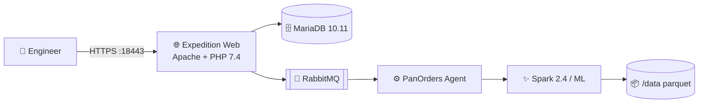

<div align="center">

# 🛡️ PA-Converter

### Palo Alto Expedition · Firewall Config Converter (Docker)

[](https://github.com/TufaylAhmed/PA-Converter)
[](https://www.npmjs.com/package/@sequr3/pa-converter)
[](https://github.com/TufaylAhmed/PA-Converter)
[](https://docs.docker.com/compose/)
[](https://github.com/TufaylAhmed/PA-Converter)
[](https://nodejs.org/)

**Convert · Import · Optimize · ML-assist** firewall configurations with Expedition, packaged for modern Docker Desktop.

```
╔══════════════════════════════════════════════════════════════╗
║   🔥  Vendor configs  ──►  PA-Converter  ──►  PAN-OS XML   ║
║       Fortinet · Cisco · Checkpoint · Palo Alto · more       ║
╚══════════════════════════════════════════════════════════════╝
```

[Quick Start](#-quick-start) · [Architecture](#-architecture) · [Features](#-features) · [ML / Spark](#-machine-learning--spark) · [CLI](#-cli-commands)

</div>

---

## ✨ Overview

**PA-Converter** is a Dockerized packaging of **Palo Alto Networks Expedition 5.45.4** for **macOS, Windows, and Linux**. It runs the Expedition web UI in Docker so you can migrate and convert firewall configurations without a dedicated Ubuntu VM.

| Capability | Status |
|:-----------|:------:|
| 🌐 Expedition web UI (HTTPS) | ✅ |
| 🔐 Seed login (`admin` / `paloalto`) | ✅ |
| 📥 Palo Alto `running-config.xml` import | ✅ |
| 📥 Fortinet config import | ✅ |
| 🐇 Background jobs (RabbitMQ + PanOrders) | ✅ |
| 🧠 Machine Learning / Spark 2.4 | ✅ |
| 🍎 Apple Silicon (ARM64) Docker | ✅ |
| 🪟 Windows + Docker Desktop (WSL2) | ✅ |

> ⚠️ For engineering / lab use. Expedition itself remains Palo Alto Networks software.

---

## 🚀 Quick Start

### Prerequisites (all platforms)

- ✅ **Node.js 18+** (macOS / Linux `npx` path)
- ✅ **Docker Desktop** with Compose v2 ([macOS](https://docs.docker.com/desktop/) · [Windows](https://docs.docker.com/desktop/setup/install/windows-install/) · Linux) — *not* required for the Windows MSI
- 🪟 **Windows MSI:** BIOS virtualization / WSL2 (setup enables features for you)

**No login, token, or `.npmrc` required** for end users.

| Path | Who | Command / download |
|------|-----|-------------------|
| **npm / npx** | macOS / Linux | `npx @sequr3/pa-converter start` |
| **MSI / portable ZIP** | Windows | [GitHub Releases](https://github.com/TufaylAhmed/PA-Converter/releases) |
| **git clone** | contributors | clone this repo, then `npm start` |

> If an old `~/.npmrc` still has `@tufaylahmed:registry=https://npm.pkg.github.com`, **delete that line** or installs may ask for a GitHub PAT.

---

### 🍎 macOS / Linux — npx (public npm, no auth)

```bash
# Start Docker Desktop, then:
npx @sequr3/pa-converter@5.46.15 start

# Day-to-day:
npx @sequr3/pa-converter status
npx @sequr3/pa-converter logs -f
npx @sequr3/pa-converter stop
```

Package: [`@sequr3/pa-converter`](https://www.npmjs.com/package/@sequr3/pa-converter) on **npmjs.org**.

First `start` builds the web image (several minutes). Then open **https://localhost:18443** (accept the self-signed cert) → `admin` / `paloalto`.

---

### 🪟 Windows — self-contained `.msi` (recommended)

**End users only need the MSI** — no Docker Desktop, Node.js, or npm account.

1. Download **`PA-Converter-5.46.15.msi`** (or the portable ZIP) from [Releases](https://github.com/TufaylAhmed/PA-Converter/releases).
2. Run the MSI (allow UAC). Leave **Finish setup** checked.
3. If Windows asks to reboot to enable WSL, reboot once — setup continues automatically.
4. Wait for first-time provisioning (downloads Ubuntu/Docker packages and builds images).
5. Open **https://localhost:18443** → `admin` / `paloalto`.

Later: Start Menu → **PA-Converter** → **Start / Stop / Status**.

> Needs 64-bit Windows 10/11, BIOS virtualization, and internet on **first** setup only.

Build the MSI (CI/Windows):

```powershell
cd installer\windows
powershell -ExecutionPolicy Bypass -File .\build.ps1 -Version 5.46.15
```

---

### Run from git clone

```bash
git clone https://github.com/TufaylAhmed/PA-Converter.git
cd PA-Converter
git lfs pull             # optional offline Spark bundle for Docker build

npm start                # or: npm link && pa-converter start
```
Open the UI:

| Protocol | URL |
|:---------|:----|
| 🔒 HTTPS | **https://localhost:18443** |
| 🌐 HTTP  | http://localhost:18080 |

Accept the self-signed certificate, then sign in:

```
👤  admin
🔑  paloalto
```

```bash
expedition status
expedition logs -f
expedition stop
```

### Ports

| Environment variable | Default | Maps to |
|:---------------------|:-------:|:--------|
| `EXPEDITION_PORT` | `18443` | Container `443` (HTTPS) |
| `EXPEDITION_HTTP_PORT` | `18080` | Container `80` (HTTP) |

---

## 🏗 Architecture



| Service | Role |
|:--------|:-----|
| **web** | Expedition UI + APIs + Spark/ML runtime |
| **db** | MariaDB with Expedition seed schemas |
| **rabbitmq** | Job queue for PanOrders / background tasks |

---

## 🎯 Features

### 📂 Configuration conversion & import

- Import **Palo Alto** running configs (`running-config.xml`)
- Import **Fortinet** and other vendor configs supported by Expedition parsers
- Project-based workflow inside the Expedition UI

### 🧠 Machine Learning & Spark

- OpenJDK 11 + **Spark 2.4.3** baked into the web image
- ML server IP auto-wired to the container on start
- Parquet / temp paths default to **`/data`**
- PanOrders agent started with Compose-aware `RABBITMQ_HOST`

### 🧰 Ops-friendly packaging

- One CLI: `expedition start | stop | status | logs | build`
- Persistent volumes for DB, user space, and ML data
- Health checks aligned with Expedition’s ML dashboard

---

## 🖥 CLI Commands

```bash
expedition start      # ▶️  Build (if needed) and start Compose stack
expedition stop       # ⏹  Stop containers
expedition status     # 📡  Show stack status
expedition logs       # 📜  Tail logs (add -f to follow)
expedition build      # 🔨  Rebuild the web image
```

Optional environment overrides:

```bash
export EXPEDITION_PORT=18443
export EXPEDITION_HTTP_PORT=18080
export EXPEDITION_IMAGE=panw/expedition-web:5.45.4
export EXPEDITION_PROJECT=panw-expedition
```

---

## 📁 Repository layout

```
PA-Converter/
├── 📜 README.md
├── 📦 package.json              # @panw/expedition private package
├── 🚀 bin/expedition.js         # CLI entrypoint
├── 🌐 app/                      # Expedition web root → /var/www/html
├── 🗄️ databases/                # Seed SQL (pandb, pandbRBAC, …)
├── 🐳 docker/
│   ├── docker-compose.yml
│   ├── web/                     # Dockerfile + entrypoint
│   ├── initdb/                  # DB bootstrap
│   └── spark/                   # Spark 2.4 bundle (Git LFS)
└── 🧪 tests/                    # Playwright smoke tests
```

---

## 🧪 Smoke tests

With the stack running:

```bash
cd tests
npm install
npx playwright install chromium

node login.spec.mjs
node import-paloalto.spec.mjs
node import-fortinet.spec.mjs
node ml-health.spec.mjs
```

Default test base URL: `https://localhost:18443` (override with `EXPEDITION_URL`).

---

## 📦 Publish (maintainers)

### Docker image

```bash
docker build -t <private-registry>/expedition-web:5.45.4 -f docker/web/Dockerfile .
docker push <private-registry>/expedition-web:5.45.4

EXPEDITION_IMAGE=<private-registry>/expedition-web:5.45.4 expedition start
```

### Public npm (`@sequr3/pa-converter`)

```bash
npm login   # account sequr3
npm publish --access public
# If the version is staged: approve with 2FA / recovery codes, then it goes live.
```

Package page: https://www.npmjs.com/package/@sequr3/pa-converter  
2FA / recovery codes: https://www.npmjs.com/settings/sequr3/tfa/list

---

## 📝 Notes

- ⏱️ First `start` builds the image and initializes the DB volume (several minutes).
- 💾 DB data lives in Docker volume `expedition-db` until `docker compose down -v`.
- 🧠 Spark/ML assets under `docker/spark/` use **Git LFS** — run `git lfs install` && `git lfs pull` after clone if needed.
- 🏷️ This project packages Expedition for **engineering / lab** workflows.

---

## 👤 Maintainer

**Tufail Ahmed Sheikh** ([@TufaylAhmed](https://github.com/TufaylAhmed)) · npm **[@sequr3](https://www.npmjs.com/~sequr3)**

---

<div align="center">

**PA-Converter** · Expedition 5.45.4 · [`@sequr3/pa-converter`](https://www.npmjs.com/package/@sequr3/pa-converter) · [GitHub](https://github.com/TufaylAhmed/PA-Converter)

</div>
